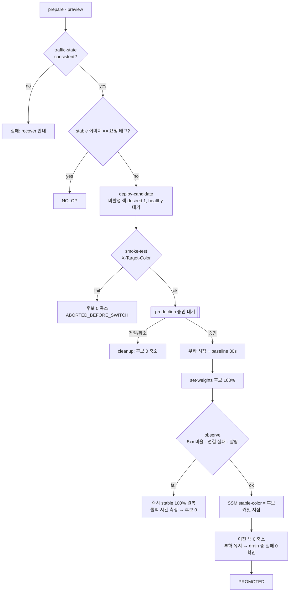
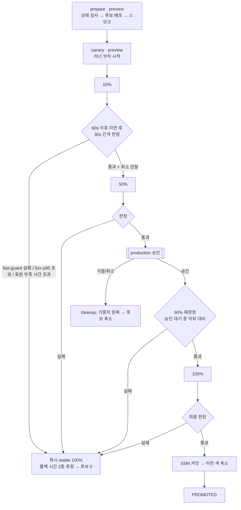

# GitHub Actions 워크플로우

| 워크플로우 | 트리거 | 역할 | AWS Role |
| --- | --- | --- | --- |
| `ci.yml` | PR, push main, tag `v*.*.*`, 수동(`ref`) | 테스트 · shellcheck · actionlint → arm64 이미지 빌드 → Trivy → ECR push | `pda-gha-ci` |
| `blue-green.yml` | 수동 (`image_tag`) | 비활성 색 배포 → 스모크 → **승인** → 100% 전환 → 관찰 → 실패 시 원복 | `pda-gha-deploy` |
| `canary.yml` | 수동 (`mode=deploy\|recover`) | 10 → 50 → **승인** → 재판정 → 100%, 단계별 지표 게이트 + 자동 롤백 / 중단된 배포 복구 | `pda-gha-deploy` |
| `destroy.yml` | 수동 (`confirm=destroy-runtime`) | runtime 스택 삭제 (bootstrap 은 유지) | `pda-gha-infra` |

## 레포 설정 (사용자가 직접)

**Environments**

| 이름 | 보호 규칙 | 용도 |
| --- | --- | --- |
| `preview` | 없음 | 후보 배포, 스모크, 정리 |
| `production` | Required reviewer = 본인, **Prevent self-review 끔** | 100% 전환 직전 승인 |
| `infra` | Required reviewer = 본인 | runtime destroy |

배포 브랜치/태그 규칙: `main`, `v*`. Required reviewer 를 무료로 쓰려면 **public 레포**여야 한다(arm64 호스티드 러너, code scanning 도 동일).

**Variables** (Secrets 는 쓰지 않는다 — 장기 자격증명이 없다)

`AWS_REGION`, `AWS_ROLE_ARN_CI`, `AWS_ROLE_ARN_DEPLOY`, `AWS_ROLE_ARN_INFRA`, `ECR_REPOSITORY`, `TF_STATE_BUCKET` — 값은 `infra/terraform/bootstrap` 의 `terraform output`.

ALB·TG·리스너 ARN 은 변수로 두지 않는다. runtime 을 재생성하면 바뀌므로 스크립트가 이름(`pda-*`)으로 매번 조회한다.

## 보안 원칙

- AWS 인증은 OIDC 만 사용. 워크플로우 최상위 `permissions: {}`, job 마다 필요한 권한만 부여.
- 서드파티 액션은 **전체 커밋 SHA 로 고정**하고 주석에 버전을 남긴다(태그 변조 공급망 공격 대비).
- `pull_request` 에는 어떤 AWS Role 도 허용하지 않는다(PR 에서는 테스트만).
- 트래픽 전환은 `scripts/aws/set-weights.sh`(`aws elbv2 modify-listener`) 한 곳에서만 일어난다. 전환을 숨기는 액션(CodeDeploy, ECS 배포 액션의 blue/green 등)은 쓰지 않는다.

## blue-green.yml 흐름



## canary.yml 흐름



### 두 층 게이트

| 게이트 | 원천 | 장점 | 한계 | 역할 |
| --- | --- | --- | --- | --- |
| `metric-gate.sh` | CloudWatch ALB 지표 (TG 단위) | 서버 측, 전체 트래픽 | 60초 해상도 + 1~2분 지연 | **권위 있는 판정** (5xx 비율, p95, 최소 요청 수) |
| `fast-guard.sh` | 러너 부하 CSV (`X-App-Version`) | 지연 없음 (로컬 측정 약 2초 감지) | 합성 트래픽만 봄 | **조기 감지** |

- 둘 중 하나라도 실패하면 롤백한다. 표본 부족(11)도 최대 대기 시간을 넘기면 롤백 — 증거 없이 승격하지 않는다.
- 5xx 데이터 포인트가 없으면 0 으로 본다. p95 는 창 전체를 period 하나로 조회한다(percentile 은 평균할 수 없음).
- 임계값은 Variables 로 덮어쓸 수 있다: `GATE_MAX_5XX_RATE`(0.01), `GATE_MAX_P95_MS`(500), `GATE_MIN_REQUESTS`(50), `GATE_WINDOW_SECONDS`(180), `GATE_MAX_WAIT_SECONDS`(420).
- 롤백 시간은 두 가지로 잰다: **판정 → 가중치 원복 검증**(파이프라인 반응 시간), **판정 → 마지막 후보 응답**(사용자 영향 종료).

### 오프라인 테스트 (CI 의 test job 에서 실행)

```bash
scripts/aws/test-metric-gate.sh   # fixture 5종: 통과 / 5xx 초과 / p95 초과 / 5xx 데이터 없음 / 표본 부족
tests/test-canary-run.sh          # 가짜 aws CLI 로 단계 진행·롤백 판정·가중치 상태 검증
```

## 실패 시나리오별 동작

| 시나리오 | 트래픽 | 동작 | 결과 배지 |
| --- | --- | --- | --- |
| 상태 불일치 (이전 배포 중단) | 변경 없음 | 시작 전에 거부, recover 안내 | 실패 |
| 같은 이미지 재배포 | 변경 없음 | 아무것도 하지 않음 | `NO_OP` |
| 후보 기동/헬스체크 실패 | 변경 없음 (후보 0%) | 후보 0 축소 | `ABORTED_BEFORE_SWITCH` |
| 스모크 실패 | 변경 없음 | 후보 0 축소, "롤백할 트래픽 없음" 명시 | `ABORTED_BEFORE_SWITCH` |
| 승인 거절 / 대기 중 취소 | 변경 없음 | `cleanup` job 이 후보 가중치 0 확인 후 축소 | 취소 |
| 관찰 중 5xx·연결 실패·알람 | 후보 100% → **stable 100%** | 즉시 원복 (이전 색 태스크가 아직 떠 있음) → 후보 0 | `ROLLED_BACK` |
| 전환 후 러너 취소/실패 | 섞인 상태 가능 | `if: failure() \|\| cancelled()` 로 원복 단계 실행 | `ROLLED_BACK` |
| SSM 커밋 이후 실패 (축소 단계) | 후보 100% 유지 | 롤백하지 않음 (커밋 포인터 기준) | 경고 |

- 원복은 리스너 가중치만 되돌리므로 즉시 끝난다. `scale_down_previous=false` 로 실행하면 이전 색을 유지해 승격 후에도 즉시 복귀할 수 있다.
- `blue-green.yml`, `canary.yml`, `destroy.yml` 은 같은 `concurrency: pda-traffic` 그룹이다. 트래픽을 바꾸는 실행은 동시에 하나만 돈다(대기 중 실행은 하나만 유지되고, 새 실행이 오면 이전 대기 실행은 취소된다).

## 측정해서 Job Summary 에 남기는 값

| 값 | 측정 방법 |
| --- | --- |
| 후보 안정화 시간 | `deploy-candidate.sh` (update-service → healthy) |
| 승인 대기 시간 | `gh api` 로 prepare 완료 시각 ~ switch 시작 시각 |
| 총 소요 (승인 대기 포함/제외) | prepare 시작 기준 |
| 롤백 소요 | 판정 시각 → `set-weights.sh` 반영 검증 시각 |
| 배포 중 실패 요청 수 | 러너 부하 CSV (`load.sh`) → `summarize.sh --format markdown` |

## AWS 시연 절차

1. `git push origin main v1.0.0 v2.0.0 v2.1.0` → `ci.yml` 이 태그 이미지를 ECR 에 push
2. `infra/terraform/runtime` apply (blue = v1.0.0)
3. `blue-green.yml` `image_tag=v2.0.0` → 승인 → **PROMOTED** 확인
4. `blue-green.yml` `image_tag=v1.0.0`, `fault_rate=0.5` → 승인 → 관찰 중 **ROLLED_BACK** 확인
5. `canary.yml` `image_tag=v2.1.0` (stable = v2.0.0) → 10 → 50 → 승인 → **PROMOTED**
6. `canary.yml` `fault_rate=0.2` → 10% 단계에서 **ROLLED_BACK(5xx)**
7. `canary.yml` `fault_delay_ms=800` → **ROLLED_BACK(p95)**
8. 실행 중 Cancel → 다음 실행이 상태 불일치로 거부 → `canary.yml mode=recover` → **RECOVERED**
9. `destroy.yml` `confirm=destroy-runtime`
