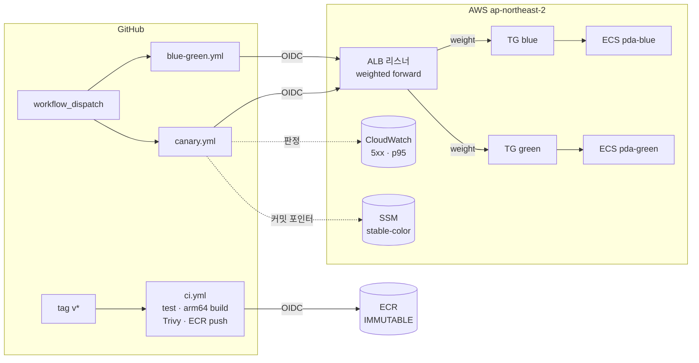
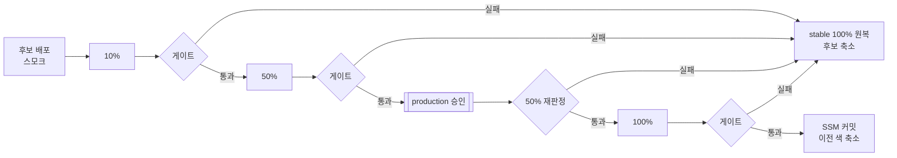

# progressive-delivery-actions

**GitHub Actions 로 ALB 가중치를 직접 제어하는 Blue-Green · 카나리 배포 파이프라인.**
지표가 나빠지면 사람 개입 없이 이전 버전으로 되돌린다. 실제 AWS(ECS Fargate + ALB)에서 정상 배포 2회, 장애 롤백 4회(주입 3 + **실제 코드 결함 1**)를 실행해 검증했다.


*실제 AWS 녹화 — `v3.0.0`(초록)이 10% 트래픽을 받자 일부 사용자에게 500(빨간 선)이 나고, 파이프라인이 60초 만에 감지해 `v2.1.1`(파랑) 100% 로 되돌린다. 단위 테스트와 스모크 테스트는 통과한 결함이다.*

| 무중단 배포 | 자동 롤백 | 롤백 판정 | 장기 자격증명 |
| --- | --- | --- | --- |
| 배포 중 요청 **6,511건 실패 0** | 장애 **4/4 회 롤백** | 전환 후 **15초** 감지 · **8초** 원복 | **0개** (GitHub OIDC) |

`Spring Boot 4.1` `Java 21` `Docker (arm64)` `AWS ECS Fargate` `ALB` `CloudWatch` `Terraform` `GitHub Actions` `OIDC` `Trivy`

---

## 1. 문제

배포는 장애가 가장 자주 시작되는 지점이다. 흔한 배포 파이프라인은 "새 버전을 올리는 것"까지만 자동화하고, **새 버전이 나쁠 때** 무엇을 할지는 사람에게 맡긴다.

이 프로젝트는 반대로 **실패 처리를 파이프라인의 주 기능**으로 설계했다.

1. 새 버전은 일부 트래픽(10% → 50%)에만 먼저 노출한다.
2. 단계마다 서버 지표로 판정하고, 기준을 넘으면 **즉시 이전 버전으로 되돌린다**.
3. 판정할 근거(표본)가 부족하면 승격하지 않는다.
4. 파이프라인이 중간에 끊겨도 트래픽 상태를 감지하고 복구할 수 있어야 한다.

서비스는 일부러 작게 만들었다 — 쿠폰 발급 API 하나. 버전마다 할인 정책만 다르다(v1 정액 → v2 정률). "할인 로직 변경"은 커머스에서 실제로 위험한 배포의 전형이다.

## 2. 설계



### 핵심 결정

| 결정 | 이유 | 대안을 버린 이유 |
| --- | --- | --- |
| **GitHub Actions 가 `aws elbv2 modify-listener` 로 가중치를 직접 바꾼다** | 전환·판정·롤백 로직이 파이프라인 코드에 그대로 드러나고, 리뷰·테스트할 수 있다 | CodeDeploy · Argo Rollouts · ECS 내장 blue/green 은 로직을 숨긴다 |
| **두 층 게이트**: CloudWatch(권위) + 러너 부하 기반 fast guard(조기 감지) | ALB 지표는 60초 해상도 + 1~2분 지연. 그 사이 장애를 클라이언트 측에서 먼저 잡는다 | CloudWatch 알람 액션만으로는 반응이 늦고 판정 근거가 Summary 에 남지 않는다 |
| **표본 부족도 롤백** | 증거 없이 승격하지 않는다 | "에러가 없으니 통과"는 트래픽이 없을 때도 통과한다 |
| **승인 후 재판정** | 승인 대기 동안 아무도 지표를 보지 않는다 | 승인 즉시 100% 는 대기 중 악화를 놓친다 |
| **리스너 가중치 = 진실 원천, SSM = 커밋 포인터** ([ADR](docs/adr/0001-traffic-state.md)) | 50/50 같은 중간 상태에서도 stable 을 판별하고, 중단된 배포를 감지·복구(`mode=recover`) | 가중치만으로는 판별 불가, S3/DynamoDB 는 이 규모에 과함 |
| **릴리즈 = git 태그 = 이미지 태그** (ECR IMMUTABLE) | 롤백 대상 이미지가 바뀌지 않는다 | 기능 플래그는 두 코드 경로가 모든 이미지에 남는다 |
| **장애 주입은 실제 HTTP 500 / 지연, 헬스체크는 제외** | ALB 지표가 그대로 잡고, ECS 가 태스크를 교체해 시연이 흐려지지 않는다 | |
| **OIDC 만 사용, Role 3개 분리**(ci / deploy / infra) | 장기 키 0. PR 에는 어떤 Role 도 허용하지 않는다 | |
| **NAT Gateway 없음** — public subnet + 태스크 SG 는 ALB 에서만 | 시연 환경 고정비 최소화 (시간당 약 $0.1) | NAT·VPC 엔드포인트는 시간당 고정비 |
| **종료 시간 정합성**: weight 0 → drain 30s → graceful 20s → stopTimeout 30s | 다운타임 0 | |

### 배포 흐름 (canary.yml)



## 3. 결과 — 실제 AWS 실측

전체 수치와 타임라인: **[docs/results.md](docs/results.md)**

| 시나리오 | 결과 | 핵심 수치 |
| --- | --- | --- |
| Blue-Green `v1 → v2` | **PROMOTED** | 요청 2,056 / 실패 0 · 서버 p95 5ms · 이전 색 drain 17s |
| Blue-Green, 후보 에러 50% | **ROLLED_BACK** | 전환 → 감지 15s → 원복 8s · 사용자 영향 18.9s |
| 카나리, 후보 에러 20% | **ROLLED_BACK** | 10% 단계에서 차단 · 전체 5xx 1.89% |
| 카나리, 후보 지연 800ms | **ROLLED_BACK** | CloudWatch p95 805ms > 500ms · 10% 단계에서 차단 |
| 카나리 `v2.0 → v2.1` | **PROMOTED** | 10 → 50 → 승인 → 재판정 → 100 · 요청 4,455 / 실패 0 · 16분 |
| 카나리 `v2.1 → v3.0` **실제 코드 결함** | **ROLLED_BACK** | 단위·스모크 테스트 통과한 NPE(사용자 약 25%) · 10% 에서 **60초** 감지 → 7초 원복 |

로컬(nginx 로 ALB 를 흉내 낸 환경)에서도 같은 시나리오를 먼저 검증했다 → [infra/local](infra/local/README.md). 롤백 판정 → 원복 618~767ms.

## 4. 실제로 부딪힌 문제

AWS 에 처음 적용하면서 다섯 번 막혔다. 전부 [docs/troubleshooting.md](docs/troubleshooting.md) 에 원인과 판단을 남겼다. 그중 셋:

- **Trivy 게이트가 첫 릴리즈를 막았다.** Spring Boot 가 끌어온 내장 Tomcat 에 CRITICAL CVE 3건. 게이트를 완화하지 않고, 공개된 태그도 다시 쓰지 않았다 → 버전 고정 후 **패치 릴리즈**(`v1.0.1` 등)를 냈다.
- **OIDC AssumeRole 거부.** 새 레포는 GitHub 의 *immutable subject*(owner/repo 숫자 ID 포함)를 쓴다. 신뢰 정책을 그 형식으로 바꿨다 — 레포 이름 재사용 공격에도 안전해졌다.
- **destroy 워크플로우 권한 부족.** Terraform 이 refresh 중 호출하는 읽기 API(`ecr:ListTagsForResource`)가 빠져 있었다. 과금이 이어지므로 먼저 로컬에서 삭제하고, 권한을 보완한 뒤 워크플로우를 다시 검증했다.

## 5. 회고

**잘한 것**
- **로컬에서 먼저 검증했다.** nginx 가중치·JSON 로그로 ALB·CloudWatch 를 1:1 로 흉내 낸 환경에서 판정 로직과 종료 순서를 확인했다. AWS 에서는 인프라·권한 문제만 남았다.
- **판정 로직을 테스트 가능하게 만들었다.** 게이트는 셸 스크립트 + 종료 코드 규약(0 통과 / 10 초과 / 11 표본 부족)으로 분리했고, CloudWatch 응답 fixture 와 가짜 aws CLI 로 CI 에서 돌린다.
- **실패를 숨기지 않았다.** 차단·권한 오류를 우회하지 않고 기준을 지킨 채 해결했다.

**실측으로 드러난 한계와 개선**

| 발견 | 원인 | 조치 |
| --- | --- | --- |
| 카나리 10% 단계에서 fast guard 감지에 123s | 후보가 약 1 rps 만 받는데 감지 창이 30s → 최소 표본(20)을 못 채움 | 카나리용 창 120s 로 확대 → **AWS 재측정 60s** (v3 시연) |
| 감지 → 원복 7~8s 중 대부분이 대기 | GitHub Actions 의 step 전환 시간 | 판정 step 안에서 바로 원복하도록 합칠 수 있다 (미적용) |
| p95 롤백까지 187s | 표본 50건을 채울 때까지 판정 보류 (의도) | 낮은 트래픽 단계의 최소 표본·부하 rps 를 함께 조정 |
| 러너 측 지연 약 300ms | 미국 러너 → 서울 ALB 왕복 | 판정은 서버 측 CloudWatch p95 기준이라 영향 없음. 기록만 |

**테스트를 통과한 결함을 배포가 잡았다** — v3 의 결함(등급 보너스 표에 등급 2 누락 → NPE)은 단위 테스트(`u-1` = 등급 1)와 스모크 테스트(`smoke` = 등급 3)를 모두 통과했다. 사용자마다 다른 실제 트래픽에서만 드러났고, 카나리가 10% 노출 단계에서 막았다. 점진적 배포가 테스트를 대체하는 게 아니라 **테스트가 놓친 것을 잡는 마지막 안전망**이라는 점을 확인했다.

**범위 밖으로 남긴 것** — HTTPS(도메인·ACM), 오토스케일링, 실사용 트래픽 기반 판정.

## 6. AI 활용

설계·구현은 Claude Code 와 함께 했다. 단계마다 요구사항을 **프롬프트 엔지니어 에이전트**(`.claude/agents/prompt-engineer.md`)로 Role · Context · Task · Expected Output 구조의 실행 프롬프트로 고도화한 뒤 구현했고, 그 프롬프트를 [docs/prompts/](docs/prompts/) 에 남겼다. 에이전트가 다음 단계와의 인터페이스(헬스체크 경로, 종료 코드 규약, CSV 규격)를 미리 고정하게 한 덕분에 단계 간 재작업이 적었다.

## 레포 구조

```
app/                  쿠폰 API (Spring Boot 4.1, Java 21) + Dockerfile + 테스트 29개
monitor/              응답 버전 비율 실시간 차트 (순수 HTML/JS)
infra/local/          docker compose + nginx 로 ALB 가중치 재현
infra/terraform/      bootstrap(상시: OIDC·ECR·state) / runtime(시연 후 삭제: VPC·ALB·ECS)
.github/workflows/    ci · blue-green · canary · destroy
scripts/aws/          가중치 전환 · 후보 배포 · 스모크 · 지표 게이트 · 카나리 실행기
scripts/load/         부하 생성 · 요약 · fast guard
tests/                게이트 fixture · 가짜 aws CLI
docs/                 results · troubleshooting · ADR · prompts · plan
```

## 직접 실행하기

| 목적 | 문서 |
| --- | --- |
| 로컬에서 Blue-Green / 카나리 / 롤백 재현 (AWS 불필요) | [infra/local/README.md](infra/local/README.md) |
| AWS 인프라 구성 순서, 비용, 권한 | [infra/terraform/README.md](infra/terraform/README.md) |
| 워크플로우 설정, 실패 시나리오별 동작, 시연 절차 | [.github/workflows/README.md](.github/workflows/README.md) |
| 앱 엔드포인트, 환경변수, 릴리즈 | [app/README.md](app/README.md) |
