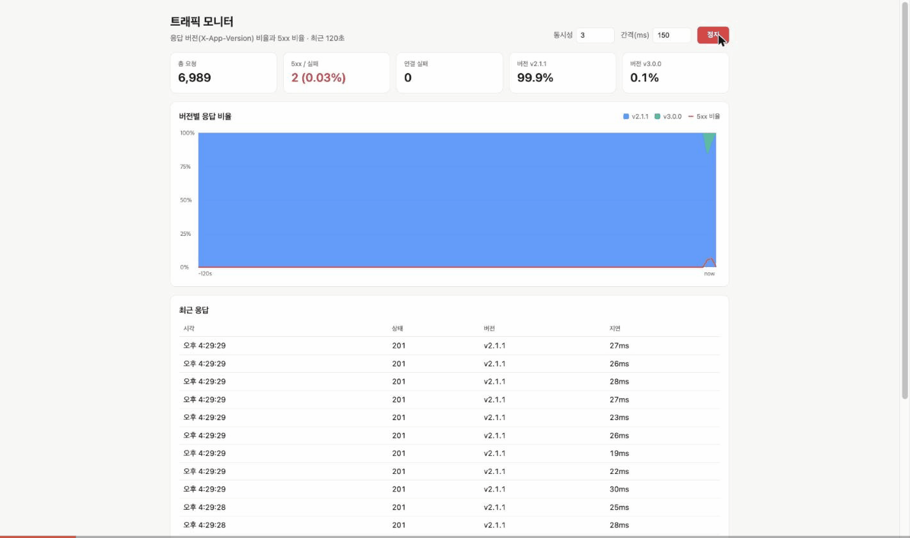
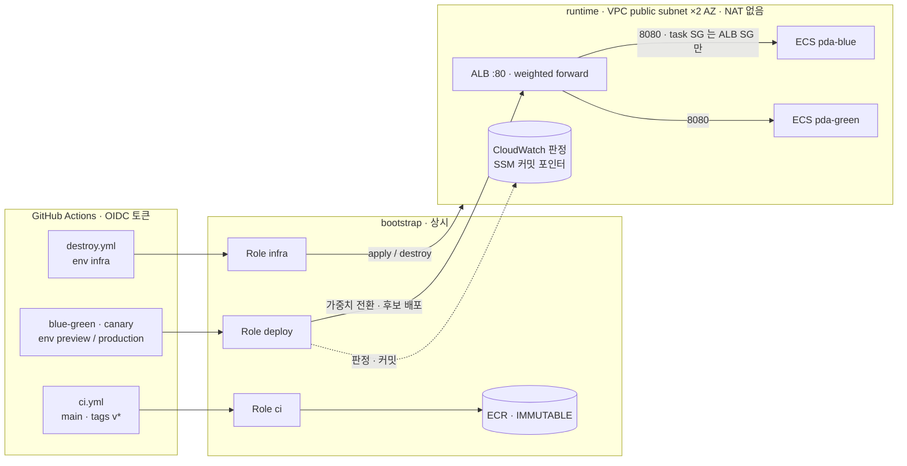
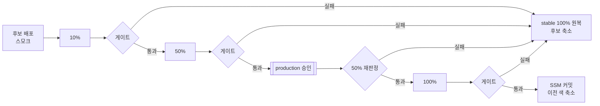

# progressive-delivery-actions

> **무엇을** — 새 버전을 일부 트래픽에만 노출하고, 지표가 나빠지면 사람 개입 없이 이전 버전으로 되돌리는 배포 파이프라인.
> **어떻게** — GitHub Actions 가 ALB 리스너 가중치를 직접 바꾸고(Blue-Green · 카나리), CloudWatch 지표 + 클라이언트 측 조기 감지로 판정한다. AWS 인증은 OIDC, 인프라는 Terraform.
> **증거** — 실제 AWS 에서 정상 배포 2회, 롤백 4회(환경변수 장애 주입 3 + **시연용으로 심은 코드 결함 1** — 단위·스모크 테스트를 통과하는 버그)를 실행했다. AWS 실측 수치에는 모두 Actions 실행 링크가 있다 → [results](docs/results.md)
>
> 1인 프로젝트. 설계와 판단은 본인, 구현은 AI(Claude Code) 보조 — [본인이 내린 판단](#6-ai-활용과-본인-판단)



*실제 AWS 녹화 — 시연용으로 버그를 심은 `v3.0.0`(초록)이 10% 트래픽을 받자 일부 사용자에게 500(빨간 선)이 나고, 파이프라인이 60초 만에 감지해 7초 만에 `v2.1.1`(파랑) 100% 로 되돌린다.*

| 무중단 배포 | 자동 롤백 | 감지 → 원복 | 장기 자격증명 |
| --- | --- | --- | --- |
| 배포 중 요청 **6,511건 실패 0**¹ | 장애 **4/4 회 롤백** | 감지 **15s**(Blue-Green) ~ **60~187s**(카나리) · 원복 **7~8s**² | **0개** (CI/CD 경로, GitHub OIDC)³ |

<sub>¹ 승격 2회 합계: Blue-Green 2,056 + 카나리 4,455. ² 감지 + 원복 합계 — Blue-Green 15 + 8 = 23s 로 목표 "자동 롤백 1분 이내" 달성, 카나리 60 + 7 = 67s ~ 187 + 7 = 194s 로 미달. 이유와 개선은 [회고](#5-회고). 시나리오마다 1회 실행한 값이다. ³ bootstrap 최초 구성과 긴급 destroy 는 로컬에서 root 세션(`aws login`)으로 했다 — 권장하지 않는 방식이며, 다시 한다면 IAM Identity Center 관리자 권한으로 한다.</sub>

`Spring Boot 4.1` `Java 21` `Docker (arm64)` `AWS ECS Fargate` `ALB` `CloudWatch` `Terraform` `GitHub Actions` `OIDC` `Trivy`

---

## 1. 문제

흔한 배포 파이프라인은 "새 버전을 올리는 것"까지만 자동화하고, **새 버전이 나쁠 때** 무엇을 할지는 사람에게 맡긴다. 이 프로젝트는 실패 처리를 파이프라인의 주 기능으로 설계했다.

1. 새 버전은 일부 트래픽(10% → 50%)에만 먼저 노출한다.
2. 단계마다 서버 지표로 판정하고, 기준을 넘으면 즉시 이전 버전으로 되돌린다.
3. 판정할 근거(표본)가 부족하면 승격하지 않는다.
4. 파이프라인이 중간에 끊겨도 트래픽 상태가 어긋났는지 감지한다 (복구 모드는 구현됨, AWS 미검증).

서비스는 일부러 작게 만들었다 — 쿠폰 발급 API 하나, 버전마다 할인 정책만 다르다. "할인 로직 변경"은 커머스에서 실제로 위험한 배포의 전형이다.

## 2. 설계



네트워크·보안 경계(SG 규칙), Role 별 sub 조건과 권한, 관측 흐름은 → **[docs/architecture.md](docs/architecture.md)**

### 핵심 결정

| 결정 | 이유 | 버린 대안 |
| --- | --- | --- |
| **Actions 가 `aws elbv2 modify-listener` 로 가중치를 직접 바꾼다** | 전환·판정·롤백 로직이 코드에 드러나고 테스트할 수 있다 | CodeDeploy · Argo Rollouts 는 로직을 숨긴다 |
| **두 층 게이트**: CloudWatch(권위) + 러너 부하 fast guard(조기 감지) | ALB 지표는 60초 해상도 + 1~2분 지연 | 알람 액션만으로는 늦고 판정 근거가 남지 않는다 |
| **표본 부족도 롤백**, **승인 후 재판정** | 증거 없이 승격하지 않는다. 승인 대기 중엔 아무도 지표를 보지 않는다 | "에러가 없으니 통과"는 트래픽이 없어도 통과한다 |
| **리스너 가중치 = 진실 원천, SSM = 커밋 포인터** ([ADR](docs/adr/0001-traffic-state.md)) | 50/50 중간 상태에서도 stable 을 판별, 중단된 배포 감지 | 가중치만으로는 판별 불가 |
| **OIDC 만, Role 3개 분리**, bootstrap / runtime 스택 분리 | CI/CD 장기 키 0, PR 은 Role 없음. runtime 을 지워도 Role·이미지 유지 | |
| **NAT 없음**, 태스크 SG 는 ALB SG 에서만 8080 | 시연 고정비 최소화(시간당 약 $0.1) | NAT · VPC 엔드포인트는 시간당 고정비 |

전체 결정 12개 → [docs/architecture.md#4](docs/architecture.md#4-설계-결정-전체)

### 배포 흐름 (canary.yml)



## 3. 결과 — 실제 AWS 실측

전체 수치와 타임라인: **[docs/results.md](docs/results.md)**

| 시나리오 | 결과 | 핵심 수치 |
| --- | --- | --- |
| Blue-Green `v1 → v2` | **PROMOTED** | 요청 2,056 / 실패 0 · 서버 p95 5ms · 이전 색 drain 17s |
| Blue-Green, 후보 에러 50% | **ROLLED_BACK** | 감지 15s → 원복 8s · 결함 버전 응답 구간 18.9s |
| 카나리, 후보 에러 20% | **ROLLED_BACK** | 10% 단계 · 감지 123s(fast guard, 창 확대 전) → 원복 7s |
| 카나리, 후보 지연 800ms | **ROLLED_BACK** | 10% 단계 · CloudWatch p95 805ms, 감지 187s → 원복 7s |
| 카나리 `v2.0 → v2.1` | **PROMOTED** | 10 → 50 → 승인 → 재판정 → 100 · 요청 4,455 / 실패 0 · 16분 |
| 카나리 `v2.1 → v3.0` **심어 둔 코드 결함**(플래그 주입 없음) | **ROLLED_BACK** | 단위·스모크 통과한 NPE(사용자 약 25%) · 10% 단계 · 감지 60s → 원복 7s · [결함 diff](https://github.com/seungji2001/progressive-delivery-actions/compare/v2.1.1...v3.0.0) |

로컬(nginx 로 ALB 를 흉내 낸 환경)에서 같은 시나리오를 먼저 검증했다 → [infra/local](infra/local/README.md). 로컬 원복은 618~767ms.

## 4. 실제로 부딪힌 문제

AWS 에 처음 적용하면서 다섯 번 막혔다 → [docs/troubleshooting.md](docs/troubleshooting.md). 그중 셋:

- **Trivy 게이트가 첫 릴리즈를 막았다.** 내장 Tomcat 의 CRITICAL CVE 3건. 게이트를 완화하지 않고 공개된 태그도 다시 쓰지 않았다 → 버전 고정 후 **패치 릴리즈**(`v1.0.1` 등).
- **OIDC AssumeRole 거부.** 새 레포는 GitHub *immutable subject*(owner/repo 숫자 ID)를 쓴다. 신뢰 정책을 그 형식으로 바꿔 레포 이름 재사용 공격에도 안전해졌다.
- **destroy 권한 부족.** Terraform refresh 가 호출하는 읽기 API 가 빠져 있었다. 과금이 이어지므로 로컬에서 먼저 삭제하고, 권한 보완 후 워크플로우로 실제 35개 리소스 삭제까지 검증했다.

장애 대응 절차는 [docs/runbook.md](docs/runbook.md) 에 정리했다.

## 5. 회고

**잘한 것**
- **로컬에서 먼저 검증했다.** nginx 가중치 · JSON 로그로 ALB · CloudWatch 를 흉내 낸 환경에서 판정 로직과 종료 순서를 확인했고, AWS 에서는 인프라·권한 문제만 남았다.
- **판정 로직을 테스트 가능하게 만들었다.** 게이트를 셸 스크립트 + 종료 코드 규약(0 통과 / 10 초과 / 11 표본 부족)으로 분리하고, CloudWatch 응답 fixture 와 가짜 aws CLI 로 CI 에서 돌린다.
- **테스트를 통과한 결함을 배포가 잡았다.** 시연을 위해 일부러 심은 결함이지만, 환경변수 주입이 아니라 실제로 흔한 형태의 코드 버그다. v3 결함(등급 보너스 표에 등급 2 누락 → NPE)은 단위 테스트(`u-1` = 등급 1)와 스모크(`smoke` = 등급 3)를 통과했고, 사용자마다 다른 실제 트래픽에서만 드러났다. 카나리는 테스트를 대체하지 않고, **테스트가 놓친 것을 잡는 마지막 안전망**이다.

**실측으로 드러난 한계와 개선**

| 발견 | 원인 | 조치 |
| --- | --- | --- |
| 카나리 롤백이 1분 목표를 넘었다 (67~194s) | 10% 단계 후보는 약 1 rps · ALB 지표 60초 해상도 · 최소 표본 50 | fast guard 창을 30s → 120s 로 넓혔고 다음 실행에서 감지 123s → 60s. 단, 조건이 다른 실행 1회씩의 비교라 창 확대만의 효과로 단정할 수 없다. p95 는 표본 대기가 의도된 설계 |
| 감지 → 원복 7~8s 중 대부분이 대기 | GitHub Actions step 전환 시간 | 판정 step 안에서 바로 원복하도록 합칠 수 있다 (미적용) |
| 러너 측 지연 약 300ms | 미국 러너 → 서울 ALB 왕복 | 판정은 서버 측 p95 기준이라 영향 없음 |

**프로덕션이라면 — 알고 내린 선택**

| 한계 | 지금의 선택 이유 | 운영 환경에서는 |
| --- | --- | --- |
| 색마다 태스크 1개 (단일 AZ 가능) | 시연 비용 | desired ≥ 2, AZ 분산. "다운타임 0" 은 배포 전환 구간 기준이다 |
| fast guard 가 러너의 합성 부하에 의존 | 10% 단계에서도 표본을 보장하는 시연 설계 | 실제 트래픽의 ALB 지표로 최소 표본까지 대기, 앱 수준 지표(에러율·지연) 병행 |
| 알람에 SNS 없음 | 판정은 워크플로우가 하므로 | 배포 시간 외 장애를 위해 알림 채널 연결 |
| HTTP:80, 공개 ALB, `X-Target-Color` 로 비활성 색 접근 가능 | 도메인 없음, 러너 접근 필요, 스모크용 | ACM + HTTPS, 스모크는 내부 경로 또는 인증 헤더 |
| ECR `v*` 이미지 최근 10개만 보존 | 저장 비용 | 롤백 보장 기간에 맞춘 보존 정책 |
| 승인자가 본인 1인, 시연 중 승인은 API 로 자동 처리 | 1인 프로젝트 | 승인자 분리(Prevent self-review), 수동 승인 |
| `mode=recover` AWS 미검증 | 시연 범위 | 장애 훈련으로 실제 중단 → 복구 검증 |
| 시나리오마다 1회 실행 | 비용·시간 | 같은 조건 반복 측정으로 감지 시간 분포 확보 |
| 상태 없는 앱(인메모리) | 배포 전략에 집중 | DB 스키마 변경은 expand → migrate → contract 로 두 버전이 동시에 동작하게 한다 |

면접 예상 질문과 답 → [docs/interview-notes.md](docs/interview-notes.md)

## 6. AI 활용과 본인 판단

설계·구현은 Claude Code 와 함께 했다. 단계마다 요구사항을 **프롬프트 엔지니어 에이전트**(`.claude/agents/prompt-engineer.md`)로 Role · Context · Task · Expected Output 구조의 실행 프롬프트로 고도화한 뒤 구현했고, 그 프롬프트를 [docs/prompts/](docs/prompts/) 에 남겼다.

AI 가 코드를 쓰는 동안 **방향을 정한 판단**은 본인이 했다:

| 판단 | 근거 |
| --- | --- |
| 첫 릴리즈가 Trivy 에 막혔을 때 게이트를 완화하지 않고 패치 릴리즈를 낸다 | [troubleshooting #1](docs/troubleshooting.md#1-trivy-게이트가-첫-릴리즈를-차단했다-critical-cve-3건) |
| 전환 로직을 CodeDeploy 에 맡기지 않고 파이프라인 코드로 드러낸다 | [architecture #4](docs/architecture.md#4-설계-결정-전체) |
| 지표 지연을 클라이언트 측 fast guard 로 메우고, 표본 부족은 롤백으로 본다 | [results #3·4](docs/results.md#34-카나리-자동-롤백) |
| 승인 직후 100% 가 아니라 한 번 더 판정한다 | [workflows README](.github/workflows/README.md) |
| 시연 비용을 위해 NAT 를 쓰지 않고 SG 로 경계를 지킨다 | [architecture #1](docs/architecture.md#1-aws-네트워크--보안-경계) |

## 레포 구조

```
app/                  쿠폰 API (Spring Boot 4.1, Java 21) + Dockerfile + 테스트 29개
monitor/              응답 버전 비율 실시간 차트 (순수 HTML/JS)
infra/local/          docker compose + nginx 로 ALB 가중치 재현, 녹화용 모니터 프록시
infra/terraform/      bootstrap(상시: OIDC·Role·ECR·state) / runtime(시연 후 삭제: VPC·ALB·ECS)
.github/workflows/    ci · blue-green · canary · destroy
scripts/aws/          가중치 전환 · 후보 배포 · 스모크 · 지표 게이트 · 카나리 실행기
scripts/load/         부하 생성 · 요약 · fast guard
tests/                게이트 fixture · 가짜 aws CLI
docs/                 architecture · results · troubleshooting · runbook · interview-notes · ADR · prompts · plan
```

## 직접 실행하기

| 목적 | 문서 |
| --- | --- |
| 로컬에서 Blue-Green / 카나리 / 롤백 재현 (AWS 불필요) | [infra/local/README.md](infra/local/README.md) |
| AWS 인프라 구성 순서, 비용, 권한 | [infra/terraform/README.md](infra/terraform/README.md) |
| 워크플로우 설정, 실패 시나리오별 동작, 시연 절차 | [.github/workflows/README.md](.github/workflows/README.md) |
| 앱 엔드포인트, 환경변수, 릴리즈 | [app/README.md](app/README.md) |

> AWS 리소스는 시연 후 bootstrap 까지 전부 삭제했다(2026-10-22). 다시 실행하려면 terraform README 의 순서대로 bootstrap 부터 만든다.
