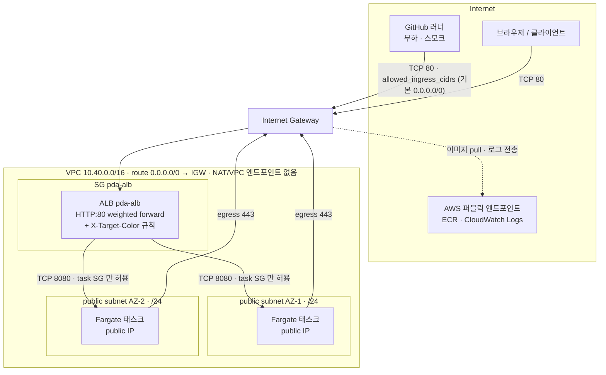
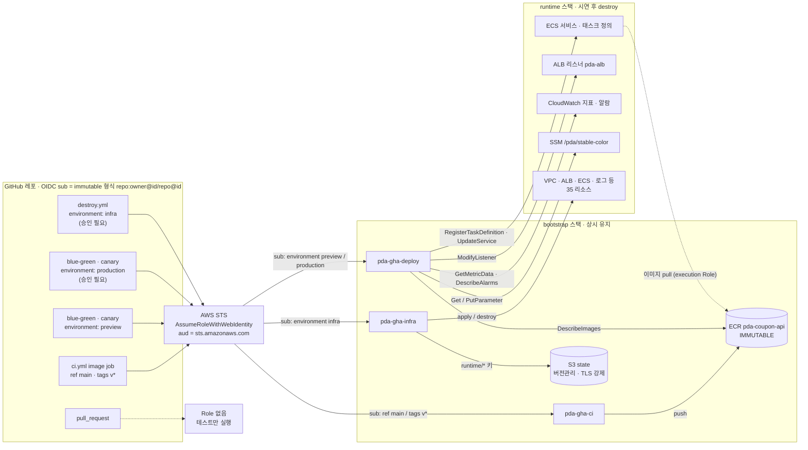
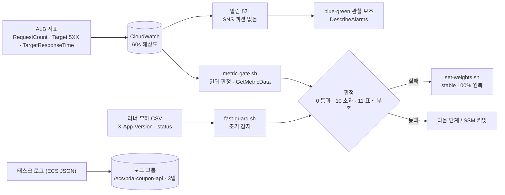

# 아키텍처 상세

README 의 요약도를 경계별로 나눠 그린다. 모든 노드와 규칙은 `infra/terraform/**` 와 `.github/workflows/**` 에서 그대로 옮겼다 — 각 그림 아래 "출처" 참고.

1. [AWS 네트워크 · 보안 경계](#1-aws-네트워크--보안-경계)
2. [CI/CD · OIDC 신뢰 경계](#2-cicd--oidc-신뢰-경계)
3. [관측 · 판정 데이터 흐름](#3-관측--판정-데이터-흐름)
4. [설계 결정 전체](#4-설계-결정-전체)

## 1. AWS 네트워크 · 보안 경계

- 태스크는 public IP 를 받지만 **인바운드는 ALB SG 에서 오는 8080 만** 열려 있다. 인터넷에서 태스크로 직접 들어오는 경로는 없다.
- blue / green 서비스는 같은 두 서브넷을 공유하고, ECS 가 태스크를 서브넷에 배치한다(그림의 태스크 두 개는 배치 위치를 뜻하며 색과 1:1 이 아니다).
- 서브넷 `map_public_ip_on_launch = false` — public IP 는 서비스 설정 `assign_public_ip = true` 로만 붙는다.

| 규칙 | 출처 | 이유 |
| --- | --- | --- |
| ALB ingress TCP 80 ← `allowed_ingress_cidrs` | `runtime/network.tf` `aws_vpc_security_group_ingress_rule.alb_http` | 러너가 스모크·부하를 보내야 해서 IP 를 좁히기 어렵다 (한계: README) |
| ALB egress TCP 8080 → task SG | `aws_vpc_security_group_egress_rule.alb_to_tasks` | ALB 는 태스크로만 나간다 |
| task ingress TCP 8080 ← ALB SG | `aws_vpc_security_group_ingress_rule.task_from_alb` | 태스크 직접 접근 차단 |
| task egress TCP 443 → 0.0.0.0/0 | `aws_vpc_security_group_egress_rule.task_https` (`#trivy:ignore:AWS-0104`) | NAT·엔드포인트 없이 ECR·Logs 퍼블릭 엔드포인트 접근 |

| 구성 요소 | 값 | 출처 |
| --- | --- | --- |
| 리스너 | HTTP:80, forward blue 100 / green 0, `ignore_changes = [default_action]` | `runtime/alb.tf` |
| 리스너 규칙 | priority 10 `X-Target-Color: blue`, 11 `green` → 해당 TG | `aws_lb_listener_rule.target_color` |
| Target group | `pda-blue`, `pda-green` · ip · 8080 · `/health/readiness` · interval 10s · healthy/unhealthy 2 · deregistration 30s | `aws_lb_target_group.color` |
| ECS 서비스 | `pda-blue` desired 1, `pda-green` desired 0 · 태스크 정의 `pda-coupon-api` 공유 · circuit breaker rollback · `ignore_changes = [task_definition, desired_count]` | `runtime/ecs.tf` |
| 태스크 | Fargate ARM64 · 0.5 vCPU / 1 GB · `stopTimeout` 30s | `aws_ecs_task_definition.app` |
| 태스크 Role | execution: ECR pull + Logs (AWS 관리형 정책) · task: 권한 없음 | `runtime/iam.tf` |

출처: `infra/terraform/runtime/network.tf`, `alb.tf`, `ecs.tf`, `iam.tf`, `variables.tf`

## 2. CI/CD · OIDC 신뢰 경계

- **왜 스택을 나눴나** — Role 과 ECR 을 runtime 과 함께 지우면 `destroy.yml` 이 다음 번에 자기 자신을 실행할 권한을 잃고, 롤백 대상 이미지도 사라진다. bootstrap 은 사용량 과금뿐이라 비용이 거의 0 이다.
- **PR 차단** — 신뢰 정책 어디에도 `pull_request` sub 가 없다. 포크 PR 이 AWS 에 접근할 수 없다.
- **infra Role 권한 상승 방지** — infra Role 은 `pda-ecs-*` Role 을 만들 수 있다. 처음에는 붙일 정책에 제한이 없어 "관리자 정책 Role 을 만들어 태스크로 실행"하는 경로가 있었다. 독립 점검에서 발견해 `iam:PolicyARN` 조건으로 ECS 실행 정책만 허용하고 `PutRolePolicy` 를 제거했다. 남은 위험: `ecs:*`·`ec2:*` 등 서비스 범위는 여전히 넓어 `infra` 승인에 의존한다. 운영 환경이라면 permissions boundary 와 리소스 태그 조건을 더한다. (코드 반영, AWS 재적용은 하지 않음 — bootstrap 삭제 상태)
- **immutable subject** — sub 에 owner·repo 숫자 ID 가 들어 있어, 레포를 지우고 같은 이름으로 다시 만들어도 Role 을 가로챌 수 없다([troubleshooting #2](troubleshooting.md#2-oidc-assumerole-이-거부됐다-immutable-subject)).

| Role | 허용 sub | 권한 범위 | 보호 장치 |
| --- | --- | --- | --- |
| `pda-gha-ci` | `ref:refs/heads/main`, `ref:refs/tags/v*` | ECR push (해당 리포지토리만), `GetAuthorizationToken` | 브랜치·태그 조건, Trivy CRITICAL 차단 후에만 push |
| `pda-gha-deploy` | `environment:preview`, `environment:production` | 태스크 정의 등록, `service/pda-cluster/pda-*` 업데이트, `listener/app/pda-alb/*` 수정, 지표·알람 조회, SSM 파라미터 1개, `role/pda-ecs-*` PassRole(ecs-tasks 한정) | 100% 전환은 `production` 승인 뒤에만 |
| `pda-gha-infra` | `environment:infra` | runtime 서비스 계열(region 조건), `pda-ecs-*` Role 생성·삭제(붙일 수 있는 정책은 `AmazonECSTaskExecutionRolePolicy` 하나, 인라인 정책 작성 불가), state `runtime/*` 키 | `infra` 승인 + `confirm=destroy-runtime` 입력 |

출처: `infra/terraform/bootstrap/iam_github.tf`, `ecr.tf`, `state.tf`, `.github/workflows/*.yml` (`environment`, `role-to-assume`, `permissions`)

## 3. 관측 · 판정 데이터 흐름

| 알람 | 지표 · 통계 | 임계값 | 평가 |
| --- | --- | --- | --- |
| `pda-blue-5xx`, `pda-green-5xx` | `HTTPCode_Target_5XX_Count` Sum | > 5 (`alarm_5xx_threshold`) | 60s × 1 |
| `pda-blue-p95`, `pda-green-p95` | `TargetResponseTime` p95 | > 0.5s (`alarm_p95_seconds`) | 60s × 2 |
| `pda-alb-elb-5xx` | `HTTPCode_ELB_5XX_Count` Sum | > 0 | 60s × 1 |

- 모든 알람은 `treat_missing_data = notBreaching` — 5xx 가 0 이면 데이터 포인트가 없기 때문이다.
- 판정 기준(5xx ≤ 1%, p95 ≤ 500ms, 최소 요청 50)은 알람이 아니라 `metric-gate.sh` 가 갖는다. 롤백 판정이 워크플로우 코드와 Job Summary 에 드러나게 하기 위해서다.
- 대시보드 `pda-progressive-delivery` 1개(색별 RequestCount · 5xx · p95 · HealthyHostCount).

출처: `infra/terraform/runtime/monitoring.tf`, `ecs.tf`(로그 그룹), `scripts/aws/metric-gate.sh`, `scripts/load/fast-guard.sh`, `scripts/aws/observe.sh`

## 4. 설계 결정 전체

README 에는 핵심만 남겼다. 전체 목록:

| 결정 | 이유 | 버린 대안 |
| --- | --- | --- |
| GitHub Actions 가 `aws elbv2 modify-listener` 로 가중치를 직접 바꾼다 | 전환·판정·롤백 로직이 파이프라인 코드에 드러나고 리뷰·테스트할 수 있다 | CodeDeploy · Argo Rollouts · ECS 내장 blue/green 은 로직을 숨긴다 |
| 두 층 게이트: CloudWatch(권위) + 러너 부하 fast guard(조기 감지) | ALB 지표는 60초 해상도 + 1~2분 지연 | 알람 액션만으로는 반응이 늦고 판정 근거가 Summary 에 남지 않는다 |
| 표본 부족도 롤백 | 증거 없이 승격하지 않는다 | "에러가 없으니 통과"는 트래픽이 없을 때도 통과한다 |
| 승인 후 재판정 | 승인 대기 동안 아무도 지표를 보지 않는다 | 승인 즉시 100% 는 대기 중 악화를 놓친다 |
| 리스너 가중치 = 진실 원천, SSM = 커밋 포인터 ([ADR](adr/0001-traffic-state.md)) | 50/50 같은 중간 상태에서도 stable 을 판별하고 중단된 배포를 감지한다 (복구 `mode=recover` 는 구현됨, AWS 미검증) | 가중치만으로는 판별 불가, S3/DynamoDB 는 과함 |
| 릴리즈 = git 태그 = 이미지 태그 (ECR IMMUTABLE) | 롤백 대상 이미지가 바뀌지 않는다 (보존: `v*` 최근 10개) | 기능 플래그는 두 코드 경로가 모든 이미지에 남는다 |
| 장애 주입은 실제 HTTP 500 / 지연, 헬스체크는 제외 | ALB 지표가 그대로 잡고, ECS 가 태스크를 교체해 시연이 흐려지지 않는다 | |
| OIDC 만 사용, Role 3개 분리 | CI/CD 경로의 장기 키 0, PR 은 어떤 Role 도 불가 | |
| NAT Gateway 없음, 태스크 SG 는 ALB 에서만 | 시연 환경 고정비 최소화 | NAT · VPC 엔드포인트는 시간당 고정비 |
| 종료 시간 정합성: weight 0 → drain 30s → graceful 20s → stopTimeout 30s | 전환 구간 다운타임 0 | |
| bootstrap / runtime 스택 분리 | runtime 을 지워도 Role·ECR·state 유지 | 단일 스택은 destroy 후 파이프라인 자체가 깨진다 |
| 외부 Terraform 모듈 미사용 | 전환 구조(가중치 리스너, 색별 TG/서비스)가 코드에 그대로 드러난다 | |
